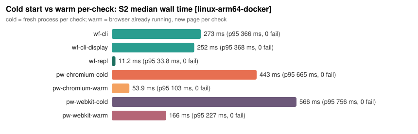
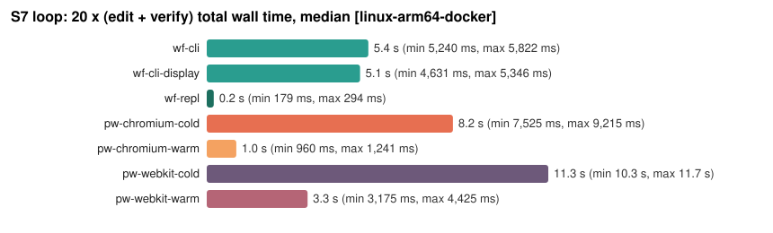
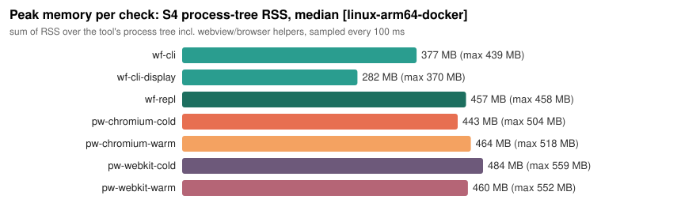
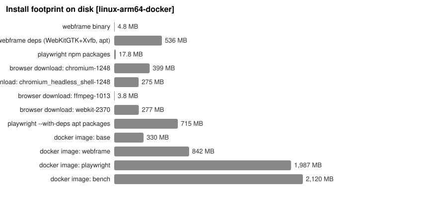
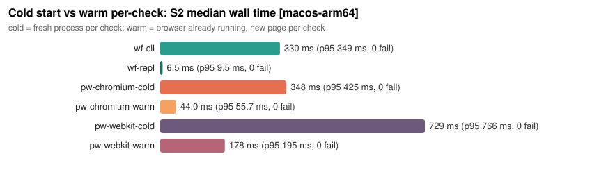
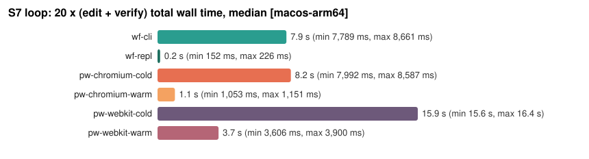
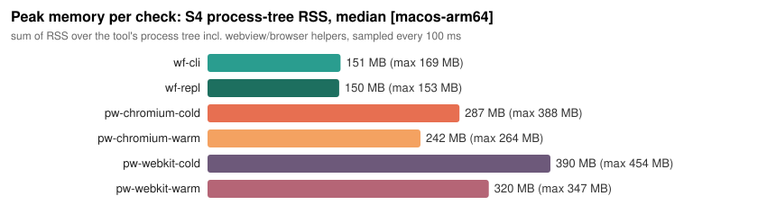
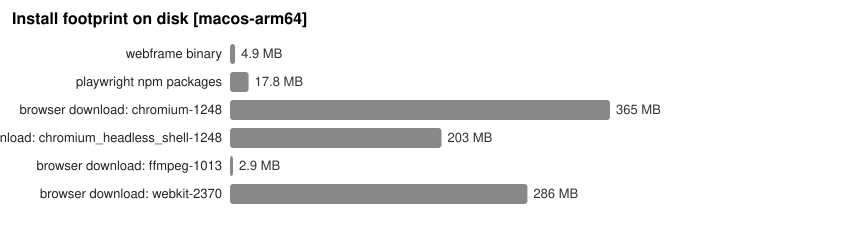

# Benchmark report: webframe vs Playwright for agent verification loops

Generated by `bench/summarize.py` from `results/raw/*/runs.jsonl`. Every number below is computed from the raw data; rerun `make bench` to regenerate. Lower is better for all timings and sizes.

Environments: `linux-arm64-docker`, `macos-arm64`. The summary uses `linux-arm64-docker`; per-environment sections follow.

## 1. Summary

- **Cold start (fresh process per check, S2):** webframe `wf-cli` 273 ms vs Playwright Chromium 443 ms (1.6x faster) and Playwright WebKit 566 ms (2.1x faster).
- **Warm (browser already running, S2):** webframe `wf-repl` 11.2 ms vs Playwright Chromium warm 53.9 ms (4.8x faster) and WebKit warm 166 ms.
- **Cold webframe vs warm Playwright:** `wf-cli` 273 ms vs `pw-chromium-warm` 53.9 ms: warm Playwright wins; webframe's cold-start edge only exists against cold Playwright.
- **Loop S7 (20 edit+verify iterations):** cold tools: wf-cli 5,368 ms, pw-chromium-cold 8,177 ms, pw-webkit-cold 11.3 s; warm tools: wf-repl 234 ms, pw-chromium-warm 983 ms, pw-webkit-warm 3,349 ms.
- **Memory (S4 peak tree RSS):** wf-cli 377 MB, wf-repl 457 MB, pw-chromium-cold 443 MB, pw-chromium-warm 464 MB, pw-webkit-cold 484 MB.
- **Failure detection (S3):** tie: wf-cli, wf-cli-display, wf-repl, pw-chromium-cold, pw-chromium-warm, pw-webkit-cold, pw-webkit-warm at 100%; all tools detected all three failures.
- **Capabilities:** Playwright 12 native vs webframe 6 of 12; webframe has no screenshots, trusted input, or request interception.
- **Does webframe make the verification loop faster?** **it depends**: **yes against cold Playwright** (1.6x faster than the fastest cold Playwright config); **no against a warm Playwright browser**, which at 53.9 ms per check beats a fresh webframe process (273 ms) 5.1x; **yes if webframe is also kept warm** (`wf-repl` 11.2 ms vs `pw-chromium-warm` 53.9 ms, 4.8x faster), at the cost of the capabilities listed below.
- Hypotheses: **H1 confirmed**; **H2 confirmed**; **H3 refuted**; **H4 confirmed**.

### Scoreboard (who won each category)

**linux-arm64-docker**

| category | winner | value | runner-up | value | margin |
| --- | --- | --- | --- | --- | --- |
| Cold start: S1 hello (median) | `wf-cli-display` | 250 ms | `pw-chromium-cold` | 457 ms | 1.8x faster |
| Cold start: S2 load + READY + no errors (median) | `wf-cli-display` | 252 ms | `pw-chromium-cold` | 443 ms | 1.8x faster |
| Cold start: S4 load + eval (median) | `wf-cli-display` | 233 ms | `pw-chromium-cold` | 415 ms | 1.8x faster |
| Warm per-check: S2 (median) | `wf-repl` | 11.2 ms | `pw-chromium-warm` | 53.9 ms | 4.8x faster |
| Warm per-check: S4 load + eval (median) | `wf-repl` | 10.2 ms | `pw-chromium-warm` | 54.4 ms | 5.3x faster |
| Loop S7, cold tools: 20 iterations (median total) | `wf-cli-display` | 5,094 ms | `pw-chromium-cold` | 8,177 ms | 1.6x faster |
| Loop S7, warm tools: 20 iterations (median total) | `wf-repl` | 234 ms | `pw-chromium-warm` | 983 ms | 4.2x faster |
| Peak memory per check: S4 (median of tree RSS) | `wf-cli-display` | 282 MB | `pw-chromium-cold` | 443 MB | 36% less |
| CPU time per check: S2, cold tools (median user+sys) | `wf-cli` | 133 ms CPU | `pw-webkit-cold` | 472 ms CPU | 72% less |
| Failure detection: S3 (min detection rate over 3 broken pages) | `tie: wf-cli, wf-cli-display, wf-repl, pw-chromium-cold, pw-chromium-warm, pw-webkit-cold, pw-webkit-warm` | 100% |  |  | all tools detected all three failures |
| Raw JS speed: S6 in-page ms (median, lower is better) | `Playwright WebKit` | 93.0 ms | `webframe (system WebKit)` | 94.5 ms | ~tie (2% faster) |
| Install footprint on disk (Linux (arm64) Docker, ubuntu:24.04 base with Node v22.23.4; dpkg installed-size deltas vs base + binaries/downloads) | `webframe stack` | 540.9 MB | `Playwright stack` | 1.6 GB | 68% smaller |
| Capabilities: native 'Yes' out of 12 | `Playwright` | 12 | `webframe` | 6 | +6 capabilities |

**macos-arm64**

| category | winner | value | runner-up | value | margin |
| --- | --- | --- | --- | --- | --- |
| Cold start: S1 hello (median) | `wf-cli` | 327 ms | `pw-chromium-cold` | 354 ms | 8% faster |
| Cold start: S2 load + READY + no errors (median) | `wf-cli` | 330 ms | `pw-chromium-cold` | 348 ms | 6% faster |
| Cold start: S4 load + eval (median) | `wf-cli` | 347 ms | `pw-chromium-cold` | 371 ms | 7% faster |
| Warm per-check: S2 (median) | `wf-repl` | 6.5 ms | `pw-chromium-warm` | 44.0 ms | 6.8x faster |
| Warm per-check: S4 load + eval (median) | `wf-repl` | 7.9 ms | `pw-chromium-warm` | 53.3 ms | 6.8x faster |
| Loop S7, cold tools: 20 iterations (median total) | `wf-cli` | 7,877 ms | `pw-chromium-cold` | 8,150 ms | 3% faster |
| Loop S7, warm tools: 20 iterations (median total) | `wf-repl` | 160 ms | `pw-chromium-warm` | 1,065 ms | 6.7x faster |
| Peak memory per check: S4 (median of tree RSS) | `wf-repl` | 150 MB | `pw-chromium-warm` | 242 MB | 38% less |
| CPU time per check: S2, cold tools (median user+sys) | `wf-cli` | 223 ms CPU | `pw-chromium-cold` | 489 ms CPU | 54% less |
| Failure detection: S3 (min detection rate over 3 broken pages) | `tie: wf-cli, wf-repl, pw-chromium-cold, pw-chromium-warm, pw-webkit-cold, pw-webkit-warm` | 100% |  |  | all tools detected all three failures |
| Raw JS speed: S6 in-page ms (median, lower is better) | `webframe (system WebKit)` | 85.0 ms | `Playwright WebKit` | 85.0 ms | ~tie (tie) |
| Install footprint on disk (macOS: webview is part of the OS) | `webframe binary (system webview not counted)` | 4.9 MB | `Playwright npm + browsers` | 874.6 MB | 99% smaller |
| Capabilities: native 'Yes' out of 12 | `Playwright` | 12 | `webframe` | 6 | +6 capabilities |

### Hypotheses

**linux-arm64-docker**

| hypothesis | verdict | evidence |
| --- | --- | --- |
| H1 webframe has lower cold-start time than Playwright for a simple load-and-check | **confirmed** | wf-cli S2 median 273 ms vs fastest Playwright cold 443 ms (1.6x faster) |
| H2 the advantage shrinks or disappears once Playwright reuses a warm browser | **confirmed** | vs cold Playwright webframe-cli is 1.62x; vs warm Playwright it is 0.20x (warm Playwright 53.9 ms beats wf-cli 273 ms): the advantage disappears |
| H3 on Linux, webframe's install footprint is not meaningfully smaller (WebKitGTK + Xvfb dominate) | **refuted** | Linux webframe stack 540.9 MB is only 32% of the Playwright stack 1.6 GB |
| H4 webframe cannot perform some checks Playwright can (screenshots, input), limiting it as a verifier | **confirmed** | webframe has no native: Screenshot, Click / type / keyboard input, Wait for selector or network idle, Network request interception, Multiple pages or tabs, Structured (JSON) output; outright impossible: Network request interception. Playwright did all 12 natively |

**macos-arm64**

| hypothesis | verdict | evidence |
| --- | --- | --- |
| H1 webframe has lower cold-start time than Playwright for a simple load-and-check | **inconclusive** | wf-cli 330 ms vs fastest Playwright cold 348 ms: within 10% |
| H2 the advantage shrinks or disappears once Playwright reuses a warm browser | **confirmed** | vs cold Playwright webframe-cli is 1.06x; vs warm Playwright it is 0.13x (warm Playwright 44.0 ms beats wf-cli 330 ms): the advantage disappears |
| H3 on Linux, webframe's install footprint is not meaningfully smaller (WebKitGTK + Xvfb dominate) | **refuted** | Linux webframe stack 540.9 MB is only 32% of the Playwright stack 1.6 GB on `linux-arm64-docker` |
| H4 webframe cannot perform some checks Playwright can (screenshots, input), limiting it as a verifier | **confirmed** | webframe has no native: Screenshot, Click / type / keyboard input, Wait for selector or network idle, Network request interception, Multiple pages or tabs, Structured (JSON) output; outright impossible: Network request interception. Playwright did all 12 natively |

## 2. Setup: `linux-arm64-docker`

| item | value |
| --- | --- |
| Environment label | `linux-arm64-docker` |
| OS | Linux Ubuntu 24.04.5 LTS (Linux-5.10.76-linuxkit-aarch64-with-glibc2.39) |
| Kernel | 5.10.76-linuxkit |
| CPU | unknown x 2 |
| RAM | 3.8 GB |
| Container | yes, --cpus=2 --memory=3g, cgroup {'cpu.max': '200000 100000', 'memory.max': '3221225472'} |
| Load average at start / end | [0.740234375, 0.8212890625, 0.54931640625] / [3.40869140625, 2.3525390625, 1.650390625] |
| webframe | commit `03155e2ba67c` (binary reports `03155e2ba67c`), glaze `?`; built with , CGO_ENABLED=0 |
| Playwright | 1.64.1 on Node v22.23.4 |
| Browsers | chromium-1248 (399.1 MB), chromium_headless_shell-1248 (275.0 MB), ffmpeg-1013 (3.8 MB), webkit-2370 (276.5 MB) |
| Browser versions | pw-chromium-warm: 156.0.8078.4, pw-webkit-warm: 27.2 |
| WebKitGTK / Xvfb (dpkg) | libwebkit2gtk-4.1-0 2.52.6-0ubuntu0.24.04.1; xvfb 2:21.1.12-1ubuntu1.9 |
| Runs | warmup 3, measured 30 per scenario and config; S7: 20 iterations x 5 loops (+1 warmup loop) |
| Order | configs shuffled every round (seed 1234); one check at a time, never in parallel |
| Sampler | every 0.1 s; 10106 samples, last sample cost 0.4 ms |
| Started / finished / duration | 2026-10-25T17:41:10+0000 / 2026-10-25T17:55:26+0000 / 852.2 s |
| Warm process launch (not timed) | wf-repl: 284 ms, pw-chromium-warm: 69.2 ms, pw-webkit-warm: 78.4 ms |
| Warm process restarts | {'wf-repl': 33, 'pw-chromium-warm': 0, 'pw-webkit-warm': 0} |
| Shared Xvfb :99 RSS (wf-cli-display, not in its tree) | 63 MB |

Timer definitions: **cold** = t0 just before spawning the process; end when the process has exited (wait4). Includes spawn, runtime/browser startup, page load, marker wait, eval, teardown. **warm** = t0 just before writing the request/navigation command to the long-lived process; end when the result line was read. Excludes browser/webview startup.

## 3. Results: `linux-arm64-docker`

### S1 hello.html: load, capture stdout, exit

| config | kind | median | p95 | min | max | peak RSS (median) | CPU (median) | pass |
| --- | --- | --- | --- | --- | --- | --- | --- | --- |
| `wf-cli` | cold | **277 ms** | 371 ms | 250 ms | 551 ms | 329 MB | 133 ms | 30/30 |
| `wf-cli-display` | cold | **250 ms** | 308 ms | 215 ms | 405 ms | 304 MB | 138 ms | 30/30 |
| `wf-repl` | warm | **18.2 ms** | 23.1 ms | 15.3 ms | 50.4 ms | 380 MB | <10 ms (sampled) | 30/30 |
| `pw-chromium-cold` | cold | **457 ms** | 723 ms | 397 ms | 792 ms | 432 MB | 500 ms | 30/30 |
| `pw-chromium-warm` | warm | **58.9 ms** | 99.5 ms | 43.8 ms | 147 ms | 418 MB | <10 ms (sampled) | 30/30 |
| `pw-webkit-cold` | cold | **595 ms** | 711 ms | 523 ms | 719 ms | 496 MB | 500 ms | 30/30 |
| `pw-webkit-warm` | warm | **159 ms** | 272 ms | 131 ms | 347 ms | 426 MB | 110 ms (sampled) | 30/30 |

### S2 ok.html: wait for READY, no errors

| config | kind | median | p95 | min | max | peak RSS (median) | CPU (median) | pass |
| --- | --- | --- | --- | --- | --- | --- | --- | --- |
| `wf-cli` | cold | **273 ms** | 366 ms | 252 ms | 390 ms | 357 MB | 133 ms | 30/30 |
| `wf-cli-display` | cold | **252 ms** | 368 ms | 223 ms | 416 ms | 267 MB | 140 ms | 30/30 |
| `wf-repl` | warm | **11.2 ms** | 33.8 ms | 7.2 ms | 100.0 ms | 445 MB | <10 ms (sampled) | 30/30 |
| `pw-chromium-cold` | cold | **443 ms** | 665 ms | 401 ms | 689 ms | 465 MB | 491 ms | 30/30 |
| `pw-chromium-warm` | warm | **53.9 ms** | 103 ms | 42.5 ms | 190 ms | 455 MB | <10 ms (sampled) | 30/30 |
| `pw-webkit-cold` | cold | **566 ms** | 756 ms | 510 ms | 1,023 ms | 487 MB | 472 ms | 30/30 |
| `pw-webkit-warm` | warm | **166 ms** | 227 ms | 140 ms | 375 ms | 459 MB | 120 ms (sampled) | 30/30 |

Median time breakdown for S2 (cumulative offsets from t0; cold: `spawn` -> ... -> `exit`; warm: `new_page` -> ... -> `response`):

| config | spawn | node_main | require | launch | first_output | nav_ack | new_page | goto | marker | page_close | browser_close | result_line | response | exit |
| --- | --- | --- | --- | --- | --- | --- | --- | --- | --- | --- | --- | --- | --- | --- |
| `wf-cli` | 0.6 ms |  |  |  | 262 ms |  |  |  | 262 ms |  |  |  |  | 273 ms |
| `wf-cli-display` | 0.6 ms |  |  |  | 240 ms |  |  |  | 240 ms |  |  |  |  | 252 ms |
| `wf-repl` |  |  |  |  |  | 2.4 ms |  |  | 11.2 ms |  |  |  |  |  |
| `pw-chromium-cold` | 0.6 ms | 41.5 ms | 261 ms | 334 ms |  |  | 386 ms | 407 ms | 407 ms | 418 ms | 442 ms | 425 ms |  | 443 ms |
| `pw-chromium-warm` |  |  |  |  |  |  | 29.6 ms | 47.4 ms | 47.4 ms | 52.6 ms |  |  | 53.9 ms |  |
| `pw-webkit-cold` | 0.6 ms | 38.7 ms | 263 ms | 338 ms |  |  | 502 ms | 526 ms | 526 ms | 533 ms | 565 ms | 548 ms |  | 566 ms |
| `pw-webkit-warm` |  |  |  |  |  |  | 139 ms | 163 ms | 163 ms | 164 ms |  |  | 166 ms |  |

### S4 ok.html: evaluate document.querySelectorAll('li').length

| config | kind | median | p95 | min | max | peak RSS (median) | CPU (median) | pass |
| --- | --- | --- | --- | --- | --- | --- | --- | --- |
| `wf-cli` | cold | **260 ms** | 298 ms | 242 ms | 323 ms | 377 MB | 123 ms | 30/30 |
| `wf-cli-display` | cold | **233 ms** | 317 ms | 211 ms | 429 ms | 282 MB | 126 ms | 30/30 |
| `wf-repl` | warm | **10.2 ms** | 19.2 ms | 7.6 ms | 34.5 ms | 457 MB | <10 ms (sampled) | 30/30 |
| `pw-chromium-cold` | cold | **415 ms** | 491 ms | 373 ms | 511 ms | 443 MB | 456 ms | 30/30 |
| `pw-chromium-warm` | warm | **54.4 ms** | 71.4 ms | 43.4 ms | 102 ms | 464 MB | <10 ms (sampled) | 30/30 |
| `pw-webkit-cold` | cold | **549 ms** | 622 ms | 497 ms | 758 ms | 484 MB | 453 ms | 30/30 |
| `pw-webkit-warm` | warm | **154 ms** | 184 ms | 128 ms | 231 ms | 460 MB | 100 ms (sampled) | 30/30 |

Median time breakdown for S4 (cumulative offsets from t0; cold: `spawn` -> ... -> `exit`; warm: `new_page` -> ... -> `response`):

| config | spawn | node_main | require | launch | first_output | nav_ack | new_page | goto | marker | eval | page_close | browser_close | result_line | response | exit |
| --- | --- | --- | --- | --- | --- | --- | --- | --- | --- | --- | --- | --- | --- | --- | --- |
| `wf-cli` | 0.6 ms |  |  |  | 247 ms |  |  |  | 247 ms | 248 ms |  |  |  |  | 260 ms |
| `wf-cli-display` | 0.5 ms |  |  |  | 220 ms |  |  |  | 220 ms | 220 ms |  |  |  |  | 233 ms |
| `wf-repl` |  |  |  |  |  | 1.7 ms |  |  | 9.4 ms | 10.2 ms |  |  |  |  |  |
| `pw-chromium-cold` | 0.6 ms | 36.0 ms | 248 ms | 315 ms |  |  | 361 ms | 379 ms | 379 ms | 386 ms | 393 ms | 414 ms | 397 ms |  | 415 ms |
| `pw-chromium-warm` |  |  |  |  |  |  | 25.6 ms | 41.7 ms | 41.7 ms | 49.0 ms | 53.8 ms |  |  | 54.4 ms |  |
| `pw-webkit-cold` | 0.7 ms | 38.5 ms | 246 ms | 320 ms |  |  | 481 ms | 502 ms | 502 ms | 506 ms | 512 ms | 547 ms | 528 ms |  | 549 ms |
| `pw-webkit-warm` |  |  |  |  |  |  | 129 ms | 148 ms | 148 ms | 153 ms | 154 ms |  |  | 154 ms |  |

### S5 spa.html: wait READY, DOM assertion

| config | kind | median | p95 | min | max | peak RSS (median) | CPU (median) | pass |
| --- | --- | --- | --- | --- | --- | --- | --- | --- |
| `wf-cli` | cold | **267 ms** | 320 ms | 246 ms | 364 ms | 348 MB | 127 ms | 30/30 |
| `wf-cli-display` | cold | **235 ms** | 283 ms | 211 ms | 327 ms | 297 MB | 126 ms | 30/30 |
| `wf-repl` | warm | **11.8 ms** | 18.6 ms | 8.1 ms | 19.4 ms | 461 MB | <10 ms (sampled) | 30/30 |
| `pw-chromium-cold` | cold | **418 ms** | 491 ms | 387 ms | 516 ms | 450 MB | 457 ms | 30/30 |
| `pw-chromium-warm` | warm | **57.6 ms** | 74.4 ms | 42.3 ms | 78.5 ms | 456 MB | <10 ms (sampled) | 30/30 |
| `pw-webkit-cold` | cold | **555 ms** | 756 ms | 484 ms | 839 ms | 465 MB | 458 ms | 30/30 |
| `pw-webkit-warm` | warm | **155 ms** | 213 ms | 132 ms | 234 ms | 445 MB | 100 ms (sampled) | 30/30 |

### S6 heavy.html: capture reported JS time

| config | kind | median | p95 | min | max | peak RSS (median) | CPU (median) | pass |
| --- | --- | --- | --- | --- | --- | --- | --- | --- |
| `wf-cli` | cold | **675 ms** | 784 ms | 614 ms | 841 ms | 549 MB | 142 ms | 30/30 |
| `wf-cli-display` | cold | **630 ms** | 772 ms | 577 ms | 1,026 ms | 488 MB | 137 ms | 30/30 |
| `wf-repl` | warm | **421 ms** | 451 ms | 382 ms | 455 ms | 588 MB | 350 ms (sampled) | 30/30 |
| `pw-chromium-cold` | cold | **1,084 ms** | 1,246 ms | 1,015 ms | 1,310 ms | 636 MB | 502 ms | 30/30 |
| `pw-chromium-warm` | warm | **671 ms** | 758 ms | 609 ms | 775 ms | 655 MB | 660 ms (sampled) | 30/30 |
| `pw-webkit-cold` | cold | **1,015 ms** | 1,196 ms | 918 ms | 1,229 ms | 674 MB | 487 ms | 30/30 |
| `pw-webkit-warm` | warm | **565 ms** | 666 ms | 498 ms | 773 ms | 675 MB | 590 ms (sampled) | 30/30 |

In-page JS time reported by the page (engine speed, independent of startup):

| config | js_ms median | user agent |
| --- | --- | --- |
| `wf-cli` | 94.5 ms | `Mozilla/5.0 (X11; Ubuntu; Linux aarch64) AppleWebKit/605.1.15 (KHTML, like Gecko) Version/` |
| `wf-cli-display` | 94.0 ms | `Mozilla/5.0 (X11; Ubuntu; Linux aarch64) AppleWebKit/605.1.15 (KHTML, like Gecko) Version/` |
| `wf-repl` | 96.0 ms | `Mozilla/5.0 (X11; Ubuntu; Linux aarch64) AppleWebKit/605.1.15 (KHTML, like Gecko) Version/` |
| `pw-chromium-cold` | 149 ms | `Mozilla/5.0 (X11; Linux x86_64) AppleWebKit/537.36 (KHTML, like Gecko) HeadlessChrome/156.` |
| `pw-chromium-warm` | 150 ms | `Mozilla/5.0 (X11; Linux x86_64) AppleWebKit/537.36 (KHTML, like Gecko) HeadlessChrome/156.` |
| `pw-webkit-cold` | 93.5 ms | `Mozilla/5.0 (Macintosh; Intel Mac OS X 10_15_7) AppleWebKit/605.1.15 (KHTML, like Gecko) V` |
| `pw-webkit-warm` | 92.5 ms | `Mozilla/5.0 (Macintosh; Intel Mac OS X 10_15_7) AppleWebKit/605.1.15 (KHTML, like Gecko) V` |

### S3 broken pages: detection and message quality

`detected` = the tool surfaced an error signal before the page's READY marker (or exited non-zero). Message quality: `full+stack` (message + source location/stack or URL), `message` (text only), `generic` (e.g. `Script error.`), `none`.

| config | page | detected | message quality | median time | first error line captured (sample) |
| --- | --- | --- | --- | --- | --- |
| `wf-cli` | throw | 100% | full+stack | 291 ms | `Uncaught Error: boom: intentional uncaught exception` |
| `wf-cli` | rejection | 100% | full+stack | 295 ms | `Unhandled promise rejection: TypeError: nope: intentional unhandled rejection` |
| `wf-cli` | resource | 100% | full+stack | 271 ms | `Failed to load resource: <script> http://127.0.0.1:37927/missing.js` |
| `wf-cli-display` | throw | 100% | full+stack | 251 ms | `Uncaught Error: boom: intentional uncaught exception` |
| `wf-cli-display` | rejection | 100% | full+stack | 264 ms | `Unhandled promise rejection: TypeError: nope: intentional unhandled rejection` |
| `wf-cli-display` | resource | 100% | full+stack | 245 ms | `Failed to load resource:  http://127.0.0.1:37927/missing.png` |
| `wf-repl` | throw | 100% | full+stack | 57.8 ms | `Uncaught Error: boom: intentional uncaught exception` |
| `wf-repl` | rejection | 100% | full+stack | 59.6 ms | `Unhandled promise rejection: TypeError: nope: intentional unhandled rejection` |
| `wf-repl` | resource | 100% | full+stack | 61.9 ms | `Failed to load resource: <script> http://127.0.0.1:37927/missing.js` |
| `pw-chromium-cold` | throw | 100% | full+stack | 485 ms | `Error: boom: intentional uncaught exception` |
| `pw-chromium-cold` | rejection | 100% | full+stack | 490 ms | `TypeError: nope: intentional unhandled rejection` |
| `pw-chromium-cold` | resource | 100% | full+stack | 467 ms | `404 http://127.0.0.1:37927/missing.png` |
| `pw-chromium-warm` | throw | 100% | full+stack | 102 ms | `Error: boom: intentional uncaught exception` |
| `pw-chromium-warm` | rejection | 100% | full+stack | 108 ms | `TypeError: nope: intentional unhandled rejection` |
| `pw-chromium-warm` | resource | 100% | full+stack | 106 ms | `404 http://127.0.0.1:37927/missing.png` |
| `pw-webkit-cold` | throw | 100% | full+stack | 608 ms | `Error: boom: intentional uncaught exception` |
| `pw-webkit-cold` | rejection | 100% | message | 608 ms | `Unhandled Promise Rejection: TypeError: nope: intentional unhandled rejection` |
| `pw-webkit-cold` | resource | 100% | full+stack | 580 ms | `404 http://127.0.0.1:37927/missing.png` |
| `pw-webkit-warm` | throw | 100% | full+stack | 204 ms | `Error: boom: intentional uncaught exception` |
| `pw-webkit-warm` | rejection | 100% | message | 204 ms | `Unhandled Promise Rejection: TypeError: nope: intentional unhandled rejection` |
| `pw-webkit-warm` | resource | 100% | full+stack | 198 ms | `404 http://127.0.0.1:37927/missing.png` |

### S7 loop: 20 x (edit ok.html, run S2+S4), total wall time

| config | kind | median | p95 | min | max | peak RSS (n/a) | CPU (median) | pass |
| --- | --- | --- | --- | --- | --- | --- | --- | --- |
| `wf-cli` | cold | **5,368 ms** | 5,799 ms | 5,240 ms | 5,822 ms | n/a | n/a | 5/5 |
| `wf-cli-display` | cold | **5,094 ms** | 5,344 ms | 4,631 ms | 5,346 ms | n/a | n/a | 5/5 |
| `wf-repl` | warm | **234 ms** | 285 ms | 179 ms | 294 ms | n/a | n/a | 5/5 |
| `pw-chromium-cold` | cold | **8,177 ms** | 9,201 ms | 7,525 ms | 9,215 ms | n/a | n/a | 5/5 |
| `pw-chromium-warm` | warm | **983 ms** | 1,233 ms | 960 ms | 1,241 ms | n/a | n/a | 5/5 |
| `pw-webkit-cold` | cold | **11.3 s** | 11.7 s | 10.3 s | 11.7 s | n/a | n/a | 5/5 |
| `pw-webkit-warm` | warm | **3,349 ms** | 4,280 ms | 3,175 ms | 4,425 ms | n/a | n/a | 5/5 |

Per-iteration statistics inside the loop (each iteration = rewrite ok.html, load, wait READY, eval li count + revision):

| config | kind | median | p95 | min | max | peak RSS (median) | CPU (median) | pass |
| --- | --- | --- | --- | --- | --- | --- | --- | --- |
| `wf-cli` | cold | **243 ms** | 317 ms | 227 ms | 386 ms | 357 MB | 116 ms | 100/100 |
| `wf-cli-display` | cold | **220 ms** | 276 ms | 193 ms | 361 ms | 291 MB | 120 ms | 100/100 |
| `wf-repl` | warm | **8.1 ms** | 16.4 ms | 5.8 ms | 46.3 ms | 474 MB | <10 ms (sampled) | 100/100 |
| `pw-chromium-cold` | cold | **408 ms** | 495 ms | 353 ms | 867 ms | 406 MB | 449 ms | 100/100 |
| `pw-chromium-warm` | warm | **45.8 ms** | 70.5 ms | 38.6 ms | 173 ms | 501 MB | <10 ms (sampled) | 100/100 |
| `pw-webkit-cold` | cold | **536 ms** | 726 ms | 466 ms | 804 ms | 475 MB | 446 ms | 100/100 |
| `pw-webkit-warm` | warm | **165 ms** | 235 ms | 144 ms | 401 ms | 495 MB | <10 ms (sampled) | 100/100 |

### Memory

| config | typical peak RSS (median over scenarios) | max peak RSS seen | S6 heavy peak RSS |
| --- | --- | --- | --- |
| `wf-cli` | 357 MB | 561 MB | 549 MB |
| `wf-cli-display` | 294 MB | 501 MB | 488 MB |
| `wf-repl` | 459 MB | 624 MB | 588 MB |
| `pw-chromium-cold` | 447 MB | 651 MB | 636 MB |
| `pw-chromium-warm` | 460 MB | 666 MB | 655 MB |
| `pw-webkit-cold` | 486 MB | 724 MB | 674 MB |
| `pw-webkit-warm` | 460 MB | 718 MB | 675 MB |

### Failures and exclusions

315 warmup runs were discarded by design (flagged `warmup: true` in the raw data). No measured run failed its pass condition; no run was excluded.

Warm-process restarts (process exited during the previous check and was relaunched before this one; relaunch time is *not* in the check timer): S1/wf-repl x30. For `wf-repl` this is `hello.html` calling `window.close()`, which exits webframe.

## 4. Capability matrix: `linux-arm64-docker`

Filled by running each probe (`bench/capabilities.py`, `bench/harness/pw_caps.js`) against the local pages; see `results/raw/linux-arm64-docker/capabilities.json` for the captured evidence.

| Capability | webframe | Playwright chromium | Playwright webkit |
| --- | --- | --- | --- |
| Capture console output | **Yes** - console.log -> stdout, other levels prefixed [warn]/[error] | **Yes** - page.on('console') | **Yes** - page.on('console') |
| Detect uncaught exceptions | **Yes** - stderr message + stack; -e exits 1 | **Yes** - page.on('pageerror') with message and stack | **Yes** - page.on('pageerror') with message and stack |
| Detect unhandled rejections | **Yes** - stderr 'Unhandled promise rejection: ...'; -e exits 1 | **Yes** - page.on('pageerror') | **Yes** - page.on('pageerror') |
| Detect failed resource loads | **Yes** - stderr 'Failed to load resource: <tag> url' | **Yes** - page.on('response') status>=400 and page.on('requestfailed'); both img and script reported with URL | **Yes** - page.on('response') status>=400 and page.on('requestfailed'); both img and script reported with URL |
| Evaluate JS in page and get result | **Yes** - -c: each stdin line evaluated, result printed (promises awaited) | **Yes** - page.evaluate(), structured return value | **Yes** - page.evaluate(), structured return value |
| Screenshot | **Workaround** - no screenshot API; DOM snapshot via eval (outerHTML/getBoundingClientRect), no pixels, ~1 eval round trip | **Yes** - page.screenshot() -> 32146 bytes PNG in 47 ms | **Yes** - page.screenshot() -> 35449 bytes PNG in 41 ms |
| Click / type / keyboard input | **Workaround** - no input API; synthetic DOM events via eval (el.click(), dispatchEvent). isTrusted=false, no real keyboard/mouse, no focus/IME semantics | **Yes** - page.click/fill/keyboard; events are trusted | **Yes** - page.click/fill/keyboard; events are trusted |
| Wait for selector or network idle | **Workaround** - no wait API; eval a polling Promise (webframe awaits promises). Network idle: not available (no network events exposed) | **Yes** - page.waitForSelector (#late appeared after 318 ms), goto waitUntil 'networkidle' | **Yes** - page.waitForSelector (#late appeared after 330 ms), goto waitUntil 'networkidle' |
| Network request interception | **No** - no request/route API; WF_* env vars inject string globals before scripts run but cannot alter requests; patching fetch via eval is too late for initial loads | **Yes** - page.route() fulfilled /api/items.json with 2 mocked items | **Yes** - page.route() fulfilled /api/items.json with 2 mocked items |
| Multiple pages or tabs | **Workaround** - one webview per process; run N processes (N x startup cost, no shared session) | **Yes** - browser.newPage() x2 in one browser, concurrently | **Yes** - browser.newPage() x2 in one browser, concurrently |
| Structured (JSON) output | **Workaround** - objects print as JSON (eval results and console.log args), but stdout/stderr are plain line streams: no envelope separating page output, eval results and errors; caller must parse/mark lines | **Yes** - library call; the script emits whatever JSON it wants (eval returns structured values) | **Yes** - library call; the script emits whatever JSON it wants (eval returns structured values) |
| Exit code on failure | **Yes** - -e: exit 1 on first exception (got 1); exit 2 on bad usage | **Yes** - script decides: process.exit(1) on pageerror (tested by pw_caps.js itself) | **Yes** - script decides: process.exit(1) on pageerror (tested by pw_caps.js itself) |

## 5. Footprint: `linux-arm64-docker`

| item | size |
| --- | --- |
| webframe binary | 4.8 MB |
| webframe runtime deps (libwebkit2gtk-4.1-0 + xvfb + their apt deps, installed size) | 536.2 MB |
| Playwright npm packages (playwright + playwright-core) | 17.8 MB |
| Playwright browser download: chromium-1248 | 399.1 MB |
| Playwright browser download: chromium_headless_shell-1248 | 275.0 MB |
| Playwright browser download: ffmpeg-1013 | 3.8 MB |
| Playwright browser download: webkit-2370 | 276.5 MB |
| Playwright `--with-deps` apt packages (installed size) | 715.2 MB |
| **webframe stack total** | **540.9 MB** |
| **Playwright stack total (chromium + webkit)** | **1.6 GB** |
| Docker image: base (ubuntu:24.04 + node + python) | 330.3 MB |
| Docker image: webframe stack | 841.8 MB |
| Docker image: Playwright stack | 1.9 GB |
| Docker image: both (bench) | 2.1 GB |
| Install time from clean state: webframe stack | 31 s |
| Install time from clean state: Playwright stack | 66 s |

dpkg installed sizes of the direct packages (KiB): `libjavascriptcoregtk-4.1-0 30504; libwebkit2gtk-4.1-0 97216; xvfb 2272`

- Image deltas vs base: webframe-stack +511 MB, playwright-stack +1656 MB, both (bench) +1789 MB.

- Install times are wall-clock from a fresh base container including network downloads (apt mirrors / npm / Playwright CDN); they vary with bandwidth.

- The webframe install time covers apt + fetching the source tarball; compiling with Go is excluded because upstream ships release zips, but the Go toolchain (~250 MB) would be needed to build from source.

- Playwright stack counts chromium + chromium headless shell + webkit + ffmpeg downloads plus the apt packages pulled by --with-deps for those engines.

## 2. Setup: `macos-arm64`

| item | value |
| --- | --- |
| Environment label | `macos-arm64` |
| OS | Darwin 26.3.1 (macOS-26.3.1-arm64-arm-64bit) |
| Kernel | Darwin Kernel Version 25.3.0: Wed Jan 28 20:54:46 PST 2026; root:xnu-12377.91.3~2/RELEASE_ARM64_T6000 |
| CPU | Apple M1 Pro x 10 |
| RAM | 16.0 GB |
| Container | no |
| Load average at start / end | [7.310546875, 6.01708984375, 6.54443359375] / [13.5078125, 13.1181640625, 10.70849609375] |
| webframe | commit `03155e2ba67c` (binary reports `03155e2ba67c`), glaze `?`; built with go version go1.27.1 darwin/arm64, CGO_ENABLED=0 |
| Playwright | 1.64.1 on Node v26.4.0 |
| Browsers | chromium-1248 (365.1 MB), chromium_headless_shell-1248 (203.2 MB), ffmpeg-1013 (2.9 MB), webkit-2370 (285.7 MB) |
| Browser versions | pw-chromium-warm: 156.0.8078.4, pw-webkit-warm: 27.2 |
| WebKitGTK / Xvfb (dpkg) | n/a (macOS uses the system WebKit) |
| Runs | warmup 3, measured 30 per scenario and config; S7: 20 iterations x 5 loops (+1 warmup loop) |
| Order | configs shuffled every round (seed 1234); one check at a time, never in parallel |
| Sampler | every 0.1 s; 9129 samples, last sample cost 45.3 ms |
| Started / finished / duration | 2026-10-25T19:08:46+0100 / 2026-10-25T19:22:35+0100 / 826.3 s |
| Warm process launch (not timed) | wf-repl: 288 ms, pw-chromium-warm: 96.6 ms, pw-webkit-warm: 212 ms |
| Warm process restarts | {'wf-repl': 33, 'pw-chromium-warm': 0, 'pw-webkit-warm': 1} |

Timer definitions: **cold** = t0 just before spawning the process; end when the process has exited (wait4). Includes spawn, runtime/browser startup, page load, marker wait, eval, teardown. **warm** = t0 just before writing the request/navigation command to the long-lived process; end when the result line was read. Excludes browser/webview startup.

## 3. Results: `macos-arm64`

### S1 hello.html: load, capture stdout, exit

| config | kind | median | p95 | min | max | peak RSS (median) | CPU (median) | pass |
| --- | --- | --- | --- | --- | --- | --- | --- | --- |
| `wf-cli` | cold | **327 ms** | 366 ms | 304 ms | 435 ms | 151 MB | 225 ms | 30/30 |
| `wf-repl` | warm | **14.6 ms** | 20.3 ms | 13.5 ms | 47.8 ms | 147 MB | <10 ms (sampled) | 30/30 |
| `pw-chromium-cold` | cold | **354 ms** | 381 ms | 332 ms | 446 ms | 310 MB | 490 ms | 30/30 |
| `pw-chromium-warm` | warm | **47.6 ms** | 56.3 ms | 41.0 ms | 60.6 ms | 244 MB | <10 ms (sampled) | 30/30 |
| `pw-webkit-cold` | cold | **727 ms** | 804 ms | 689 ms | 811 ms | 393 MB | 575 ms | 30/30 |
| `pw-webkit-warm` | warm | **183 ms** | 208 ms | 168 ms | 229 ms | 329 MB | 90 ms (sampled) | 30/30 |

### S2 ok.html: wait for READY, no errors

| config | kind | median | p95 | min | max | peak RSS (median) | CPU (median) | pass |
| --- | --- | --- | --- | --- | --- | --- | --- | --- |
| `wf-cli` | cold | **330 ms** | 349 ms | 311 ms | 355 ms | 151 MB | 223 ms | 30/30 |
| `wf-repl` | warm | **6.5 ms** | 9.5 ms | 6.1 ms | 10.9 ms | 148 MB | <10 ms (sampled) | 30/30 |
| `pw-chromium-cold` | cold | **348 ms** | 425 ms | 327 ms | 489 ms | 301 MB | 489 ms | 30/30 |
| `pw-chromium-warm` | warm | **44.0 ms** | 55.7 ms | 42.1 ms | 57.7 ms | 243 MB | <10 ms (sampled) | 30/30 |
| `pw-webkit-cold` | cold | **729 ms** | 766 ms | 695 ms | 794 ms | 393 MB | 578 ms | 30/30 |
| `pw-webkit-warm` | warm | **178 ms** | 195 ms | 164 ms | 244 ms | 322 MB | 80 ms (sampled) | 30/30 |

Median time breakdown for S2 (cumulative offsets from t0; cold: `spawn` -> ... -> `exit`; warm: `new_page` -> ... -> `response`):

| config | spawn | node_main | require | launch | first_output | nav_ack | new_page | goto | marker | page_close | browser_close | result_line | response | exit |
| --- | --- | --- | --- | --- | --- | --- | --- | --- | --- | --- | --- | --- | --- | --- |
| `wf-cli` | 1.7 ms |  |  |  | 315 ms |  |  |  | 315 ms |  |  |  |  | 330 ms |
| `wf-repl` |  |  |  |  |  | 0.7 ms |  |  | 6.5 ms |  |  |  |  |  |
| `pw-chromium-cold` | 1.7 ms | 36.6 ms | 191 ms | 276 ms |  |  | 319 ms | 329 ms | 329 ms | 331 ms | 347 ms | 345 ms |  | 348 ms |
| `pw-chromium-warm` |  |  |  |  |  |  | 34.8 ms | 41.9 ms | 41.9 ms | 43.6 ms |  |  | 44.0 ms |  |
| `pw-webkit-cold` | 1.7 ms | 37.5 ms | 187 ms | 366 ms |  |  | 622 ms | 642 ms | 642 ms | 646 ms | 728 ms | 722 ms |  | 729 ms |
| `pw-webkit-warm` |  |  |  |  |  |  | 166 ms | 176 ms | 176 ms | 177 ms |  |  | 178 ms |  |

### S4 ok.html: evaluate document.querySelectorAll('li').length

| config | kind | median | p95 | min | max | peak RSS (median) | CPU (median) | pass |
| --- | --- | --- | --- | --- | --- | --- | --- | --- |
| `wf-cli` | cold | **347 ms** | 394 ms | 317 ms | 438 ms | 151 MB | 234 ms | 30/30 |
| `wf-repl` | warm | **7.9 ms** | 12.9 ms | 6.8 ms | 17.5 ms | 150 MB | <10 ms (sampled) | 30/30 |
| `pw-chromium-cold` | cold | **371 ms** | 436 ms | 340 ms | 640 ms | 287 MB | 528 ms | 30/30 |
| `pw-chromium-warm` | warm | **53.3 ms** | 61.0 ms | 49.4 ms | 65.9 ms | 242 MB | <10 ms (sampled) | 30/30 |
| `pw-webkit-cold` | cold | **763 ms** | 867 ms | 722 ms | 875 ms | 390 MB | 597 ms | 30/30 |
| `pw-webkit-warm` | warm | **190 ms** | 207 ms | 180 ms | 208 ms | 320 MB | 90 ms (sampled) | 30/30 |

Median time breakdown for S4 (cumulative offsets from t0; cold: `spawn` -> ... -> `exit`; warm: `new_page` -> ... -> `response`):

| config | spawn | node_main | require | launch | first_output | nav_ack | new_page | goto | marker | eval | page_close | browser_close | result_line | response | exit |
| --- | --- | --- | --- | --- | --- | --- | --- | --- | --- | --- | --- | --- | --- | --- | --- |
| `wf-cli` | 1.8 ms |  |  |  | 329 ms |  |  |  | 329 ms | 330 ms |  |  |  |  | 347 ms |
| `wf-repl` |  |  |  |  |  | 0.8 ms |  |  | 7.1 ms | 7.9 ms |  |  |  |  |  |
| `pw-chromium-cold` | 1.9 ms | 38.2 ms | 194 ms | 288 ms |  |  | 338 ms | 348 ms | 348 ms | 354 ms | 357 ms | 371 ms | 365 ms |  | 371 ms |
| `pw-chromium-warm` |  |  |  |  |  |  | 36.2 ms | 43.6 ms | 43.6 ms | 50.2 ms | 52.2 ms |  |  | 53.3 ms |  |
| `pw-webkit-cold` | 1.8 ms | 38.1 ms | 195 ms | 385 ms |  |  | 647 ms | 668 ms | 668 ms | 670 ms | 675 ms | 762 ms | 756 ms |  | 763 ms |
| `pw-webkit-warm` |  |  |  |  |  |  | 174 ms | 185 ms | 185 ms | 188 ms | 189 ms |  |  | 190 ms |  |

### S5 spa.html: wait READY, DOM assertion

| config | kind | median | p95 | min | max | peak RSS (median) | CPU (median) | pass |
| --- | --- | --- | --- | --- | --- | --- | --- | --- |
| `wf-cli` | cold | **344 ms** | 429 ms | 321 ms | 785 ms | 151 MB | 237 ms | 30/30 |
| `wf-repl` | warm | **9.9 ms** | 16.6 ms | 7.2 ms | 20.1 ms | 147 MB | <10 ms (sampled) | 30/30 |
| `pw-chromium-cold` | cold | **371 ms** | 427 ms | 342 ms | 639 ms | 297 MB | 526 ms | 30/30 |
| `pw-chromium-warm` | warm | **52.1 ms** | 66.3 ms | 48.2 ms | 69.2 ms | 243 MB | <10 ms (sampled) | 30/30 |
| `pw-webkit-cold` | cold | **768 ms** | 833 ms | 716 ms | 864 ms | 406 MB | 611 ms | 30/30 |
| `pw-webkit-warm` | warm | **192 ms** | 242 ms | 177 ms | 304 ms | 326 MB | 100 ms (sampled) | 29/30 **FAIL** |

### S6 heavy.html: capture reported JS time

| config | kind | median | p95 | min | max | peak RSS (median) | CPU (median) | pass |
| --- | --- | --- | --- | --- | --- | --- | --- | --- |
| `wf-cli` | cold | **700 ms** | 777 ms | 665 ms | 828 ms | 292 MB | 239 ms | 30/30 |
| `wf-repl` | warm | **356 ms** | 371 ms | 345 ms | 381 ms | 303 MB | 255 ms (sampled) | 30/30 |
| `pw-chromium-cold` | cold | **879 ms** | 937 ms | 847 ms | 994 ms | 533 MB | 1135 ms | 30/30 |
| `pw-chromium-warm` | warm | **562 ms** | 594 ms | 551 ms | 601 ms | 461 MB | 580 ms (sampled) | 30/30 |
| `pw-webkit-cold` | cold | **1,048 ms** | 1,188 ms | 975 ms | 1,880 ms | 582 MB | 610 ms | 30/30 |
| `pw-webkit-warm` | warm | **534 ms** | 582 ms | 507 ms | 602 ms | 499 MB | 490 ms (sampled) | 30/30 |

In-page JS time reported by the page (engine speed, independent of startup):

| config | js_ms median | user agent |
| --- | --- | --- |
| `wf-cli` | 85.0 ms | `Mozilla/5.0 (Macintosh; Intel Mac OS X 10_15_7) AppleWebKit/605.1.15 (KHTML, like Gecko)` |
| `wf-repl` | 85.0 ms | `Mozilla/5.0 (Macintosh; Intel Mac OS X 10_15_7) AppleWebKit/605.1.15 (KHTML, like Gecko)` |
| `pw-chromium-cold` | 131 ms | `Mozilla/5.0 (Macintosh; Intel Mac OS X 10_15_7) AppleWebKit/537.36 (KHTML, like Gecko) Hea` |
| `pw-chromium-warm` | 130 ms | `Mozilla/5.0 (Macintosh; Intel Mac OS X 10_15_7) AppleWebKit/537.36 (KHTML, like Gecko) Hea` |
| `pw-webkit-cold` | 85.0 ms | `Mozilla/5.0 (Macintosh; Intel Mac OS X 10_15_7) AppleWebKit/605.1.15 (KHTML, like Gecko) V` |
| `pw-webkit-warm` | 85.0 ms | `Mozilla/5.0 (Macintosh; Intel Mac OS X 10_15_7) AppleWebKit/605.1.15 (KHTML, like Gecko) V` |

### S3 broken pages: detection and message quality

`detected` = the tool surfaced an error signal before the page's READY marker (or exited non-zero). Message quality: `full+stack` (message + source location/stack or URL), `message` (text only), `generic` (e.g. `Script error.`), `none`.

| config | page | detected | message quality | median time | first error line captured (sample) |
| --- | --- | --- | --- | --- | --- |
| `wf-cli` | throw | 100% | full+stack | 322 ms | `Uncaught Error: boom: intentional uncaught exception` |
| `wf-cli` | rejection | 100% | full+stack | 329 ms | `Unhandled promise rejection: TypeError: nope: intentional unhandled rejection` |
| `wf-cli` | resource | 100% | full+stack | 341 ms | `Failed to load resource: <script> http://127.0.0.1:63920/missing.js` |
| `wf-repl` | throw | 100% | full+stack | 56.6 ms | `Uncaught Error: boom: intentional uncaught exception` |
| `wf-repl` | rejection | 100% | full+stack | 56.9 ms | `Unhandled promise rejection: TypeError: nope: intentional unhandled rejection` |
| `wf-repl` | resource | 100% | full+stack | 60.4 ms | `Failed to load resource: <script> http://127.0.0.1:63920/missing.js` |
| `pw-chromium-cold` | throw | 100% | full+stack | 406 ms | `Error: boom: intentional uncaught exception` |
| `pw-chromium-cold` | rejection | 100% | full+stack | 416 ms | `TypeError: nope: intentional unhandled rejection` |
| `pw-chromium-cold` | resource | 100% | full+stack | 431 ms | `404 http://127.0.0.1:63920/missing.png` |
| `pw-chromium-warm` | throw | 100% | full+stack | 96.4 ms | `Error: boom: intentional uncaught exception` |
| `pw-chromium-warm` | rejection | 100% | full+stack | 96.9 ms | `TypeError: nope: intentional unhandled rejection` |
| `pw-chromium-warm` | resource | 100% | full+stack | 102 ms | `404 http://127.0.0.1:63920/missing.png` |
| `pw-webkit-cold` | throw | 100% | full+stack | 734 ms | `Error: boom: intentional uncaught exception` |
| `pw-webkit-cold` | rejection | 100% | message | 753 ms | `Unhandled Promise Rejection: TypeError: nope: intentional unhandled rejection` |
| `pw-webkit-cold` | resource | 100% | full+stack | 765 ms | `404 http://127.0.0.1:63920/missing.png` |
| `pw-webkit-warm` | throw | 100% | full+stack | 233 ms | `Error: boom: intentional uncaught exception` |
| `pw-webkit-warm` | rejection | 100% | message | 233 ms | `Unhandled Promise Rejection: TypeError: nope: intentional unhandled rejection` |
| `pw-webkit-warm` | resource | 100% | full+stack | 248 ms | `404 http://127.0.0.1:63920/missing.png` |

### S7 loop: 20 x (edit ok.html, run S2+S4), total wall time

| config | kind | median | p95 | min | max | peak RSS (n/a) | CPU (median) | pass |
| --- | --- | --- | --- | --- | --- | --- | --- | --- |
| `wf-cli` | cold | **7,877 ms** | 8,548 ms | 7,789 ms | 8,661 ms | n/a | n/a | 5/5 |
| `wf-repl` | warm | **160 ms** | 213 ms | 152 ms | 226 ms | n/a | n/a | 5/5 |
| `pw-chromium-cold` | cold | **8,150 ms** | 8,561 ms | 7,992 ms | 8,587 ms | n/a | n/a | 5/5 |
| `pw-chromium-warm` | warm | **1,065 ms** | 1,136 ms | 1,053 ms | 1,151 ms | n/a | n/a | 5/5 |
| `pw-webkit-cold` | cold | **15.9 s** | 16.3 s | 15.6 s | 16.4 s | n/a | n/a | 5/5 |
| `pw-webkit-warm` | warm | **3,729 ms** | 3,893 ms | 3,606 ms | 3,900 ms | n/a | n/a | 5/5 |

Per-iteration statistics inside the loop (each iteration = rewrite ok.html, load, wait READY, eval li count + revision):

| config | kind | median | p95 | min | max | peak RSS (median) | CPU (median) | pass |
| --- | --- | --- | --- | --- | --- | --- | --- | --- |
| `wf-cli` | cold | **342 ms** | 414 ms | 305 ms | 548 ms | 151 MB | 231 ms | 100/100 |
| `wf-repl` | warm | **6.5 ms** | 11.4 ms | 5.2 ms | 25.0 ms | 140 MB | <10 ms (sampled) | 100/100 |
| `pw-chromium-cold` | cold | **359 ms** | 438 ms | 335 ms | 521 ms | 300 MB | 514 ms | 100/100 |
| `pw-chromium-warm` | warm | **51.2 ms** | 61.1 ms | 47.1 ms | 86.4 ms | 262 MB | <10 ms (sampled) | 100/100 |
| `pw-webkit-cold` | cold | **738 ms** | 824 ms | 693 ms | 962 ms | 394 MB | 585 ms | 100/100 |
| `pw-webkit-warm` | warm | **182 ms** | 228 ms | 167 ms | 266 ms | 339 MB | <10 ms (sampled) | 100/100 |

### Memory

| config | typical peak RSS (median over scenarios) | max peak RSS seen | S6 heavy peak RSS |
| --- | --- | --- | --- |
| `wf-cli` | 151 MB | 344 MB | 292 MB |
| `wf-repl` | 148 MB | 432 MB | 303 MB |
| `pw-chromium-cold` | 300 MB | 544 MB | 533 MB |
| `pw-chromium-warm` | 244 MB | 477 MB | 461 MB |
| `pw-webkit-cold` | 394 MB | 633 MB | 582 MB |
| `pw-webkit-warm` | 327 MB | 522 MB | 499 MB |

### Failures and exclusions

270 warmup runs were discarded by design (flagged `warmup: true` in the raw data). Measured runs that failed the pass condition are counted as failures and excluded only from the timing statistics (never silently dropped):

| scenario | config | failed | reasons |
| --- | --- | --- | --- |
| S3-resource | `wf-cli` | 1/30 | timeout after 20.0s (x1) |
| S5 | `pw-webkit-warm` | 1/30 | READY not seen (x1) |

Warm-process restarts (process exited during the previous check and was relaunched before this one; relaunch time is *not* in the check timer): S1/wf-repl x30, S5/pw-webkit-warm x1. For `wf-repl` this is `hello.html` calling `window.close()`, which exits webframe.

## 4. Capability matrix: `macos-arm64`

Filled by running each probe (`bench/capabilities.py`, `bench/harness/pw_caps.js`) against the local pages; see `results/raw/macos-arm64/capabilities.json` for the captured evidence.

| Capability | webframe | Playwright chromium | Playwright webkit |
| --- | --- | --- | --- |
| Capture console output | **Yes** - console.log -> stdout, other levels prefixed [warn]/[error] | **Yes** - page.on('console') | **Yes** - page.on('console') |
| Detect uncaught exceptions | **Yes** - stderr message + stack; -e exits 1 | **Yes** - page.on('pageerror') with message and stack | **Yes** - page.on('pageerror') with message and stack |
| Detect unhandled rejections | **Yes** - stderr 'Unhandled promise rejection: ...'; -e exits 1 | **Yes** - page.on('pageerror') | **Yes** - page.on('pageerror') |
| Detect failed resource loads | **Yes** - stderr 'Failed to load resource: <tag> url' | **Yes** - page.on('response') status>=400 and page.on('requestfailed'); both img and script reported with URL | **Yes** - page.on('response') status>=400 and page.on('requestfailed'); both img and script reported with URL |
| Evaluate JS in page and get result | **Yes** - -c: each stdin line evaluated, result printed (promises awaited) | **Yes** - page.evaluate(), structured return value | **Yes** - page.evaluate(), structured return value |
| Screenshot | **Workaround** - no screenshot API; DOM snapshot via eval (outerHTML/getBoundingClientRect), no pixels, ~1 eval round trip | **Yes** - page.screenshot() -> 41523 bytes PNG in 33 ms | **Yes** - page.screenshot() -> 62708 bytes PNG in 27 ms |
| Click / type / keyboard input | **Workaround** - no input API; synthetic DOM events via eval (el.click(), dispatchEvent). isTrusted=false, no real keyboard/mouse, no focus/IME semantics | **Yes** - page.click/fill/keyboard; events are trusted | **Yes** - page.click/fill/keyboard; events are trusted |
| Wait for selector or network idle | **Workaround** - no wait API; eval a polling Promise (webframe awaits promises). Network idle: not available (no network events exposed) | **Yes** - page.waitForSelector (#late appeared after 804 ms), goto waitUntil 'networkidle' | **Yes** - page.waitForSelector (#late appeared after 314 ms), goto waitUntil 'networkidle' |
| Network request interception | **No** - no request/route API; WF_* env vars inject string globals before scripts run but cannot alter requests; patching fetch via eval is too late for initial loads | **Yes** - page.route() fulfilled /api/items.json with 2 mocked items | **Yes** - page.route() fulfilled /api/items.json with 2 mocked items |
| Multiple pages or tabs | **Workaround** - one webview per process; run N processes (N x startup cost, no shared session) | **Yes** - browser.newPage() x2 in one browser, concurrently | **Yes** - browser.newPage() x2 in one browser, concurrently |
| Structured (JSON) output | **Workaround** - objects print as JSON (eval results and console.log args), but stdout/stderr are plain line streams: no envelope separating page output, eval results and errors; caller must parse/mark lines | **Yes** - library call; the script emits whatever JSON it wants (eval returns structured values) | **Yes** - library call; the script emits whatever JSON it wants (eval returns structured values) |
| Exit code on failure | **Yes** - -e: exit 1 on first exception (got 1); exit 2 on bad usage | **Yes** - script decides: process.exit(1) on pageerror (tested by pw_caps.js itself) | **Yes** - script decides: process.exit(1) on pageerror (tested by pw_caps.js itself) |

## 5. Footprint: `macos-arm64`

| item | size |
| --- | --- |
| webframe binary | 4.9 MB |
| Playwright npm packages (playwright + playwright-core) | 17.8 MB |
| Playwright browser download: chromium-1248 | 365.1 MB |
| Playwright browser download: chromium_headless_shell-1248 | 203.2 MB |
| Playwright browser download: ffmpeg-1013 | 2.9 MB |
| Playwright browser download: webkit-2370 | 285.7 MB |

## 6. Limitations and threats to validity

- **Single machine per environment**; load average at start was [0.740234375, 0.8212890625, 0.54931640625] on 2 cores (the macOS host was not idle: editor and browsers were running). Interleaving configurations per round spreads drift across configs but does not remove it.
- **Measurement overhead**: the process sampler runs every 0.1 s and one sample cost about 0.4 ms (a `ps` call on macOS, a `/proc` scan on Linux), i.e. a constant background load that affects all configurations equally.
- **Engine differences**: webframe uses the OS WebKit; `pw-webkit-*` uses Playwright's own WebKit build with a different process model (Playwright WebKit spends ~300 ms creating a page/context; see breakdown tables). Chromium is a different engine entirely; S6 shows the raw JS speed gap.
- **Small page set** of synthetic pages on localhost; real apps with bundles, fonts and network latency will shift absolute numbers.
- **Timer boundaries differ by kind**: cold timers include process spawn and runtime startup (Go binary vs Node + `require('playwright')` ~150 ms); warm timers include pipe IPC to the long-lived process. They are compared only within their kind, except where the report says so explicitly.
- **Memory sampling** at 100 ms misses short peaks and, on macOS, relies on heuristic attribution of WebKit helper processes (no other WebKit app should be spawning processes during the run). Linux trees are exact. Xvfb started by webframe is included in its tree; the shared Xvfb for `wf-cli-display` is reported separately.
- **Container/VM overhead**: the Linux environment runs under Docker Desktop's VM on Apple Silicon; absolute numbers are not comparable to bare-metal Linux. Xvfb startup is part of every `wf-cli` run on Linux unless `wf-cli-display` is used.
- **OS file cache** was warm for all measured runs (binaries and browsers had been used by the warmup runs); no dropped-cache measurement was taken.
- **webframe hides script error details on `file://` pages** (`Script error.`), so everything here is served over http; that mode was not timed separately.
- `wf-repl` S1 relaunches the REPL after `hello.html` calls `window.close()`; that restart cost is reported, not timed.

### Assumptions made by the implementation

- Every check waits for a marker line the page itself logs (`READY`, `TIME ...`, or the hello line) rather than for a fixed delay; `window.close()` cannot be relied on in Playwright (browsers refuse to close windows a script did not open), so S1 ends when the expected line is seen and the page is closed.
- `wf-cli` runs `webframe -e -c <url>`: `-e` for the exit code, `-c` so the harness can evaluate after READY and stop the process by closing stdin (webframe otherwise only exits on `window.close()` or a signal). `wf-repl` runs `webframe -c about:blank` without `-e` (it would die on the first broken page) and navigates with `location.href`.
- Playwright warm uses `browser.newPage()` per check (a fresh context, the simplest API) and listens to `console`, `pageerror`, `requestfailed` and `response.status >= 400`; Chromium runs Playwright's default headless shell with its default flags (which already include `--no-sandbox` in containers).
- The static server sends `Cache-Control: no-store` so warm browsers refetch the edited page in S7 (any dev server does this).
- Peak RSS is the sum over the tool's process tree, sampled every 100 ms. On macOS WebKit's helper processes (WebContent, Networking, GPU) are launched via launchd, not as children; the sampler attributes new `com.apple.WebKit.*` processes to the configuration whose check was running when they appeared. CPU time for cold runs is `wait4` rusage (process + reaped descendants); for warm runs it is the sampled delta, which has 10 ms granularity and misses helpers that are not children.
- `heavy.html` is a shortened variant of webframe's `examples/bench.html` (fib, math loop, sort, allocation, JSON), 1 warmup + 3 timed passes, median reported, so a run takes a few hundred ms rather than seconds.
- No hyperfine: the correctness gate (every run must reach the verified outcome) and the stdin-driven protocols need a custom harness; it implements the same warmup + N measured runs + median/p95 reporting.

### Run-to-run variance

Only one full run per environment is present; rerun `make bench ENV_LABEL=<label>-run2` to measure run-to-run variance.

## 7. Recommendation

- If the agent **must spawn a fresh process per check** (no daemon allowed), webframe is the faster verifier here (273 ms vs 443 ms Chromium / 566 ms WebKit; 357 MB vs 465 MB peak RSS, 133 vs 491 ms CPU), provided the check only needs console output, exceptions, resource failures and JS evaluation.
- If the agent **can keep a browser process alive** across edits, a warm Playwright Chromium (53.9 ms per check) beats cold webframe (273 ms) and matches or beats `wf-repl` on everything except the raw navigation round trip (11.2 ms for wf-repl). Warm Playwright also gives screenshots, trusted input, interception and multiple pages.
- `wf-repl` is the cheapest possible loop (11.2 ms per check, ~457 MB RSS) when the agent only needs load + console + eval and can tolerate a single page per process and plain-text stdout/stderr parsing.
- Use Playwright when verification needs pixels, real input events, network mocking, waiting primitives or structured output; webframe has no equivalent and the workarounds (synthetic events, DOM dumps) change what is being verified.
- **Install footprint:** webframe stack 540.9 MB vs Playwright stack 1.6 GB (32% of Playwright). WebKitGTK + Xvfb dominate the webframe side (~536.2 MB), but the full Playwright stack is still ~3.1x larger here. On macOS the binary alone is ~5 MB because WebKit ships with the OS.

## Appendix: files

- `results/summary.csv`: aggregated medians, p95, memory, CPU, success rates for every environment, scenario and configuration.
- `results/raw/<env>/runs.jsonl`: one JSON record per check (including warmups and failures) with stdout, errors, timings, breakdown, RSS and CPU; `env.json`: hardware, versions, parameters; `capabilities.json`; `footprint.json` (Linux/Docker).
- `results/charts/*.svg`: cold start, S7 loop, peak memory, footprint per environment.
